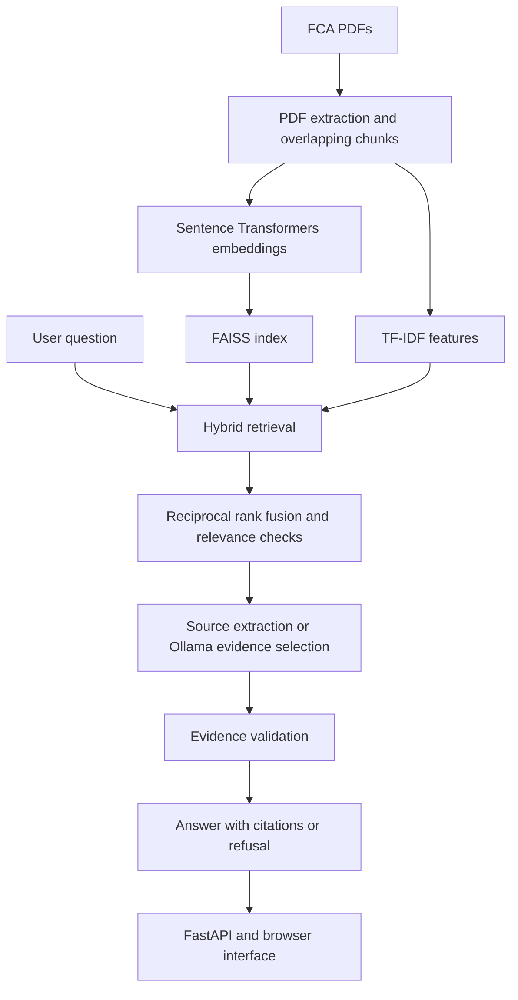

# FinIntel AI – Financial Document Intelligence (RAG)

A local question-answering assistant for UK financial regulatory documents, combining hybrid retrieval, source-aware evidence extraction and a local LLM. The application returns supporting PDF citations and withholds answers when it cannot establish sufficient evidence. It includes a FastAPI REST API, browser interface, evaluation dashboard and Docker configuration.

**Release:** 8.0.0 | **Purpose:** educational portfolio prototype, not financial or legal advice.

## Features

- PDF extraction and page-level source metadata.
- Hybrid semantic and keyword search using Sentence Transformers, FAISS, TF-IDF and reciprocal rank fusion.
- Local Llama 3.2 (3B) inference via LangChain and Ollama.
- Evidence selection, deterministic extraction for selected definitions and dates, source citations and unsupported-question handling.
- FastAPI endpoints, interactive API documentation and a web-based evaluation dashboard.
- Automated tests, reproducible evaluation scripts and local Docker deployment.

## Architecture



The system uses 700-character chunks with 200-character overlap. The dense index uses normalised `all-MiniLM-L6-v2` embeddings and FAISS `IndexFlatIP`; the lexical index uses TF-IDF. Full mode combines their rankings. Ollama selects numbered source excerpts rather than freely writing regulatory facts. Selected FCA definitions, lists and dates are extracted directly from the documents using rule-based routes, which bypass the LLM. These routes improve reliability for specific question types but limit generalisation.

## Technology stack

Python, PyPDF (with cryptography), NumPy, scikit-learn, Sentence Transformers, FAISS, LangChain, Ollama, Llama 3.2, FastAPI, Uvicorn, HTML/CSS/JavaScript, Pytest and Docker.

## Data sources

| Document | Official source |
|---|---|
| FG21/1 – Fair treatment of vulnerable customers | [FCA PDF](https://www.fca.org.uk/publication/finalised-guidance/fg21-1.pdf) |
| FG22/5 – Final non-Handbook Guidance for firms on the Consumer Duty | [FCA PDF](https://www.fca.org.uk/publication/finalised-guidance/fg22-5.pdf) |
| PS22/9 – A new Consumer Duty | [FCA PDF](https://www.fca.org.uk/publication/policy/ps22-9.pdf) |

The tested local corpus contained three original PDFs (339 pages and 1,720 passages). These are historical publication snapshots, not a live legal knowledge base. Original PDFs are not committed to the repository: use the downloader below. Source labels refer to physical PDF pages. Public availability does not itself establish permission to redistribute; consult the FCA's applicable terms before redistributing the documents or excerpts.

## Installation and usage (macOS)

Python 3.11 is recommended (the full local workflow was run on macOS with Python 3.11). Internet access is needed for initial dependency, document and model downloads. Allow disk space for the models and Python packages; the tested full Docker image reported about 10 GB disk usage.

### 1. Obtain the project and install dependencies

```bash
git clone https://github.com/echo-adityaraj/FinIntel-AI.git
cd FinIntel-AI
python3.11 -m venv .venv
source .venv/bin/activate
python -m pip install --upgrade pip
python -m pip install -r requirements-full.txt
python -m pip check
```

Alternatively, use GitHub's Code → Download ZIP and open the extracted folder in a terminal. For PDF-only mode without Ollama or FAISS, install `requirements.txt` instead. The requirements use compatible version ranges (and a pinned PDF reader), not a complete dependency lockfile.

### 2. Download the FCA documents and run tests

```bash
python -m scripts.download_documents
python -m pytest -q
```

The downloader writes the three PDFs and source manifest to `data/raw/`. The original files are required for the real-PDF tests and full/PDF modes. The expected test count for this release is 65. Official downloads may change; rerun the tests and evaluation if the source versions differ.

### 3. Start Ollama and download the model

Install Ollama from [ollama.com/download](https://ollama.com/download). Open the macOS application and check its server:

```bash
open -a Ollama
ollama list
```

If the server is not running, use `ollama serve` in a separate terminal and leave it open. Do not launch a second server if one is already running. From another terminal:

```bash
ollama pull llama3.2:3b
ollama run llama3.2:3b "Say hello in one sentence."
curl http://127.0.0.1:11434/api/tags
```

### 4. Run the assistant

From the project directory with the virtual environment active:

```bash
python -m scripts.run --mode full
```

The launcher checks the configuration, loads the documents, runs readiness checks and starts the server. The first full-mode run downloads the embedding model. Keep Ollama and the application running in separate processes. Open:

- [Chatbot and evaluation dashboard](http://127.0.0.1:8000)
- [Swagger API documentation](http://127.0.0.1:8000/docs)
- [Health endpoint](http://127.0.0.1:8000/health)

Stop the server with Ctrl+C. For offline PDF mode (after downloading PDFs), use `python -m scripts.run --mode pdf`. For the curated-summary demonstration, use `python -m scripts.run --mode starter`. Use `--check-only` with a mode to execute readiness checks without starting the server.

### Example questions

- What are the four Consumer Duty outcomes?
- What is fair value?
- When did the rules apply to closed products?
- What are the three cross-cutting rules of the Consumer Duty?
- Who won the 2022 FIFA World Cup? (An out-of-scope question that should be refused.)

## API

| Method | Endpoint | Purpose |
|---|---|---|
| GET | `/health` | Service health, corpus and configuration |
| POST | `/ask` | Question answering with citations |
| GET | `/metrics` | Evaluation results for a selected configuration |
| GET | `/docs` | Interactive OpenAPI documentation |

Example:

```bash
curl -X POST http://127.0.0.1:8000/ask \
  -H 'Content-Type: application/json' \
  -d '{"question":"What is fair value?","k":5}'
```

Responses include the answer, supporting sources, retrieved passage identifiers, latency, support flag and answer method. A successful HTTP response does not guarantee answer accuracy.

## Evaluation

The PDF benchmark comprises ten labelled questions: seven answerable and three unsupported. The table compares two measured configurations from development. The offline baseline was measured in a separate verification environment; the full configuration was measured on the project author's Mac.

| Metric | TF-IDF / extractive | Hybrid / Ollama |
|---|---:|---:|
| Page Hit@1 | 42.86% | 57.14% |
| Page Hit@3 | 42.86% | 71.43% |
| Page Hit@5 | 71.43% | 100% |
| Page Hit@10 | 85.71% | 100% |
| Expected fragment match | 85.71% | 100% |
| Labelled citation page match | 71.43% | 85.71% |
| Unsupported refusal rate | 100% | 100% |
| Answerable response rate | 85.71% | 100% |
| Mean latency | 0.079 s | 3.018 s |

Full-mode Page Hit@5 was 7/7; labelled citation page match was 6/7; refusal rate was 3/3. The evaluation includes previously debugged questions and is exploratory, not an independent holdout. Fragment and page matching are not proof of answer correctness or groundedness. Latency includes both direct-extraction and model-selection paths and should not be interpreted as LLM-only latency or a controlled cross-machine speed comparison. The separate 44-question starter benchmark uses curated summaries and is not comparable to the PDF benchmark.

To reproduce the PDF evaluation, stop the web server, keep Ollama running and execute:

```bash
CORPUS=pdf RETRIEVAL_MODE=semantic GENERATION_MODE=ollama python -m scripts.evaluate_pdf
```

For the offline comparison:

```bash
CORPUS=pdf RETRIEVAL_MODE=tfidf GENERATION_MODE=extractive python -m scripts.evaluate_pdf
```

Results are saved to `results/pdf/semantic-ollama/` and `results/pdf/tfidf-extractive/` respectively. The evaluation scripts generate detailed CSVs locally; aggregate JSON metrics are included in the repository. Restart the app to view the appropriate dashboard. See [TEST_REPORT.md](TEST_REPORT.md) for verification details and limitations.

## Docker (local deployment on macOS)

Install [Docker Desktop](https://www.docker.com/products/docker-desktop/), start it and keep Ollama running on the host. Download the PDFs first as shown above. Stop any existing server on port 8000. From the project root:

```bash
docker build --build-arg FULL=1 -t finintel-full .
docker run --rm --name finintel-ai \
  -p 127.0.0.1:8000:8000 \
  -v "$PWD/data/raw:/app/data/raw:ro" \
  -v "$PWD/results:/app/results:ro" \
  -e CORPUS=pdf \
  -e RETRIEVAL_MODE=semantic \
  -e GENERATION_MODE=ollama \
  -e OLLAMA_URL=http://host.docker.internal:11434 \
  finintel-full
```

Open http://127.0.0.1:8000. Check `docker ps` in another terminal; stop with `docker stop finintel-ai`. The container runs the Python application; Ollama runs separately on the host. A successful local Docker build, host connectivity and API execution were observed on macOS. Other platforms and cloud deployments are not verified. The first container start may download the embedding model.

## Project structure

```text
app/                  Core engine, API and browser interface
data/                 Source metadata and labelled questions
  raw/                Downloaded PDFs and manifest
scripts/              Launcher, downloader and evaluation scripts
tests/                Automated regression and API tests
results/              Aggregate evaluation metrics
Dockerfile            Container build configuration
requirements.txt      Core Python dependencies
requirements-full.txt Full RAG dependencies
TEST_REPORT.md        Verification details
```

## Limitations and future work

The corpus is small and not automatically updated. Some extraction routes are FCA-specific. The index is rebuilt in memory on startup; the relevance threshold is heuristic. Exact source excerpts can still be irrelevant or incomplete. Future work includes a larger independent benchmark, manual claim-level groundedness review, improved reranking, persistent indexing, automated document updates and deployment testing across platforms.

This project was developed with AI-assisted coding and debugging, followed by local execution, evaluation and Docker testing. It is an educational prototype and is not affiliated with the FCA. Always verify regulatory information against the official current source.
